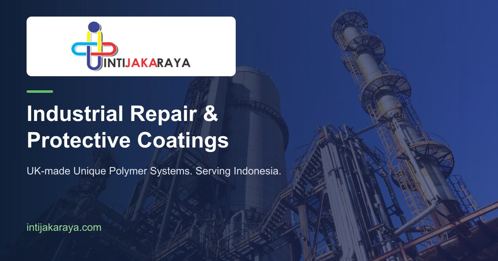
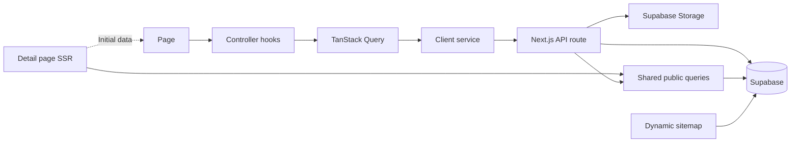

<div align="center">

# Inti Jaka Raya

### Industrial Repair & Protective Coatings

A bilingual company website, product catalog, and case study platform for **PT. Inti Jaka Raya**, with an integrated content management system.

[](package.json)
[](package.json)
[](tsconfig.json)
[](src/styles/globals.css)
[](src/utils/supabase.ts)

[Live Website](https://intijakaraya.com/) · [Product Catalog](https://intijakaraya.com/products) · [Indonesian Version](https://intijakaraya.com/id) · [Getting Started](#getting-started)

<a href="https://intijakaraya.com/">
  
</a>

*Brand and social preview artwork. Explore the live website using the links above.*

</div>

## About the project

This project presents industrial repair products and practical case studies in a responsive interface. Visitors can discover solutions by category, industry, division, and application, explore technical documentation, and switch between English and Indonesian.

The same application provides CMS screens for managing products, case studies, supporting files, and classification labels. It uses **Next.js Pages Router**, Supabase, and a consistent API → service → controller → page structure.

## Explore the website

| Experience | What you will find | Preview |
| --- | --- | --- |
| Home | Company introduction, parallax imagery, and the latest visible case studies | [Open home](https://intijakaraya.com/) |
| About | Company background and industrial maintenance expertise | [Open about](https://intijakaraya.com/about) |
| Catalog | Product/case study selection, search, and classification filters | [Open catalog](https://intijakaraya.com/products) |
| Product detail | Product information, descriptions, documents, related case studies, and gallery | Open a product card in the catalog |
| Case study detail | Problem, application context, product used, supporting documents, and gallery | Open a case study card or carousel item |
| Indonesian interface | Localized navigation, interface text, and metadata | [Open Indonesian home](https://intijakaraya.com/id) |

Detail links use database IDs; select a published item in the catalog to view an available record.

## Features

- **Responsive design** — shared brand colors and typography, mobile/tablet navigation, compact detail layouts, and a consistent footer.
- **Motion and imagery** — parallax backgrounds, scroll reveals, and a carousel with autoplay, pause controls, keyboard interaction, and reduced-motion support.
- **Product discovery** — product/case study catalog, keyword search, and category, industry, application, and division filters.
- **Detailed content** — ordered story sections, thumbnail images, galleries, document links, and links between products and case studies.
- **Content management** — create, edit, delete, and show/hide products and case studies; manage labels and uploaded media.
- **Authentication** — Supabase email/password sign-in and session checks through Next.js API routes.
- **English and Indonesian** — locale-aware routing and a navbar language switch that preserves the current page.
- **Search and sharing** — server-rendered detail content, dynamic metadata, canonical URLs, hreflang, JSON-LD, social cards, robots.txt, and a database-driven sitemap.
- **Monitoring** — Pino server logs, Vercel Analytics, and Vercel Speed Insights.

## Technology

| Area | Implementation |
| --- | --- |
| Framework | Next.js 16 with Pages Router and Turbopack |
| Interface | React 19, TypeScript, Tailwind CSS 4, Nunito Sans |
| Animation | Motion |
| Data fetching | Axios and TanStack Query |
| UI state | Zustand |
| Forms | React Hook Form |
| Backend | Next.js API routes and Supabase PostgreSQL |
| Authentication & files | Supabase Auth and Storage |
| Upload processing | Formidable and Sharp |
| Deployment | Vercel |

Exact dependency versions are recorded in [package.json](package.json) and [package-lock.json](package-lock.json).

## Architecture



- **API routes** handle HTTP requests, database access, visibility checks, and uploads.
- **Services** make HTTP requests and normalize error handling.
- **Controllers** manage query/mutation state and map API data for the interface.
- **Pages and components** render content and user interactions.
- **Detail SSR** loads public content before rendering and supplies initial data to the existing controller queries. API routes and SSR reuse the queries in `publicContent.server.ts`.

### Project structure

```text
.
├── public/                       # Brand assets, icons, images, and SVGs
├── scripts/                      # Social image and favicon generators
├── src/
│   ├── components/
│   │   ├── custom/               # Navbar, carousel, SEO, modals, sidebar
│   │   └── shared/               # Reusable UI, reveal animation, CMS inputs
│   ├── controllers/              # Query hooks, mutations, and page mappings
│   ├── hooks/                    # Translation and UI helpers
│   ├── interfaces/               # DTOs, form inputs, and page types
│   ├── pages/
│   │   ├── api/                  # Auth, catalog, products, case studies, labels
│   │   ├── cms/                  # Content management screens
│   │   ├── products/
│   │   │   ├── index.tsx         # Catalog
│   │   │   ├── [id].tsx          # Product detail
│   │   │   └── article/[id].tsx  # Case study detail
│   │   ├── index.tsx             # Home
│   │   ├── about.tsx
│   │   ├── sitemap.xml.ts
│   │   └── robots.txt.ts
│   ├── services/                 # Client API functions
│   ├── stores/                   # Zustand stores
│   ├── styles/                   # Global design tokens and Tailwind recipes
│   └── utils/                    # Supabase clients, SEO, logging, server queries
├── next.config.ts
└── vercel.json
```

## Getting started

### Requirements

- Node.js **20.9 or later**, using a supported LTS version.
- npm and Git.
- A Supabase project with the required tables, relationships, Storage buckets, and policies.

### 1. Install

```bash
git clone https://github.com/TioNovriadiPutra/inti-jaka-raya-website.git
cd inti-jaka-raya-website
npm ci
```

### 2. Configure environment variables

Create `.env.local` in the project root:

```dotenv
SUPABASE_URL=https://your-project.supabase.co
SUPABASE_PUBLISHABLE_KEY=your-supabase-publishable-key
NEXT_PUBLIC_SITE_URL=https://intijakaraya.com
LOG_LEVEL=info
```

| Variable | Required | Purpose |
| --- | --- | --- |
| `SUPABASE_URL` | Yes | Supabase project endpoint |
| `SUPABASE_PUBLISHABLE_KEY` | Yes | Publishable key used by the server-side Supabase clients |
| `NEXT_PUBLIC_SITE_URL` | No | Canonical/sitemap origin; defaults to `https://intijakaraya.com` |
| `LOG_LEVEL` | No | Pino log level; defaults to `debug` in development and `info` otherwise |

Use the target deployment's public origin for `NEXT_PUBLIC_SITE_URL`. It is read by client code and must be set before building. Keep environment files out of version control. The application does not require a Supabase service-role key.

### 3. Prepare Supabase

The repository currently does **not** include database migrations or seed data. Configure the schema before testing database-dependent pages.

| Main table | Related tables | Relationship |
| --- | --- | --- |
| `products` | `product_descriptions`, `product_galleries`, `product_documents` | One product to many descriptions, images, and documents |
| `case_studies` | `case_study_descriptions`, `case_study_galleries`, `case_study_documents` | One case study to many descriptions, images, and documents |
| `case_studies` | `products` | A case study references a product through `product_id` |
| Products and case studies | `categories`, `industries`, `divisions`, `applications` | Classification through foreign keys |

Important data conventions:

- `is_showing = true` makes a product or case study eligible for public detail pages and the sitemap.
- Gallery rows store `image_url`, `ori_width`, `ori_height`, and `is_thumbnail`.
- Description rows store `title` and `description`; document rows store `doc_url` and `doc_name`.
- Create Storage buckets named **`products`** and **`case-studies`**, with access policies suitable for the public media URLs used by the website.
- Configure database Row Level Security and Storage policies for public reads and authorized content writes. CMS navigation and sign-in UI do not replace backend access policies.
- Create an authorized Supabase Auth user to use the CMS.

If using a different Supabase project, update the Storage hostname in `images.remotePatterns` inside [next.config.ts](next.config.ts).

### 4. Start development

```bash
npm run dev
```

Open **http://localhost:3000**. Sign in through the website to work with CMS content.

### Available commands

| Command | Purpose |
| --- | --- |
| `npm run dev` | Start the development server |
| `npm run build` | Create a production build and run TypeScript validation |
| `npm start` | Serve the production build |
| `npm run lint` | Run ESLint |
| `npx tsc --noEmit` | Check TypeScript without generating files |

There is currently no dedicated automated test script in `package.json`.

## Routes and API

| Public route | Purpose |
| --- | --- |
| `/` | Home |
| `/about` | About the company |
| `/products` | Product and case study catalog |
| `/products/[id]` | Published product detail |
| `/products/article/[id]` | Published case study detail |
| `/id/...` | Indonesian version of public routes |
| `/sitemap.xml` | Published page discovery |
| `/robots.txt` | Crawler directives |

CMS screens live under `/cms/products`, `/cms/case-studies`, and `/cms/labels`, with create/edit screens for each content type.

| API group | Purpose |
| --- | --- |
| `/api/auth/login`, `/api/auth/logout`, `/api/auth/me` | Authentication and session checks |
| `/api/catalog` | Catalog search, type selection, and filters |
| `/api/carousel` | Five latest visible case studies with a thumbnail |
| `/api/product/[id]` | Public product detail |
| `/api/case-study/[id]` | Public case study detail |
| `/api/product/*`, `/api/case-study/*` | Content management operations |
| `/api/label/*`, `/api/dropdown` | Label management and dropdown data |

## Design and localization

The visual system uses navy, green, and neutral colors defined in [globals.css](src/styles/globals.css). Shared Tailwind recipes live in [ui.ts](src/styles/ui.ts); reusable components handle navigation, forms, modals, and animation.

English is the default locale. Indonesian routes use `/id`, with automatic browser-language detection disabled. The navbar language switch preserves the current page, query parameters, and URL fragment.

Interface translations are maintained in [translations.ts](src/utils/translations.ts) through [useTranslation](src/hooks/useTranslation.ts). Product names, codes, case study text, and database labels retain their original language; the switch does not machine-translate backend content. CMS screens remain in English.

## SEO and social sharing

- Server-rendered product and case study content, including initial query data.
- Per-detail titles, descriptions, canonical URLs, hreflang, and social thumbnails; brand artwork is used when no thumbnail exists.
- Open Graph and Twitter cards, plus Organization, WebSite, and page JSON-LD.
- Dynamic sitemap covering Home, About, Catalog, and visible product/case study details in EN/ID. Results are paginated and cached at the CDN for one hour.
- Hidden or missing detail records return 404. Database errors remain server errors; a sitemap query failure returns an uncached 503 instead of a partial list.
- CMS and error pages remain `noindex, nofollow`.
- Favicon files are available at `/icon.png` and `/favicon.ico`.

Regenerate the brand assets when needed:

```bash
node scripts/generate-social-image.mjs
node scripts/generate-site-icons.mjs
```

After deployment, inspect a published product and case study in Google Search Console, check `/sitemap.xml`, and test social previews. Search engines and social platforms may retain cached titles, icons, and preview images.

## Deploy to Vercel

1. Import this repository into Vercel with the **Next.js** framework preset.
2. Configure the environment variables for the intended deployment environment.
3. Use `npm run build` as the build command and leave the output directory at its framework default.
4. Deploy and verify the public pages, API routes, authentication, and uploaded media.
5. Enable Vercel Analytics and Speed Insights for the project if you want to collect those metrics. Their components are already included in `_app.tsx`.

This project needs a Next.js server runtime for API routes, server-rendered details, and the sitemap. Do not configure it as a static SPA or rewrite every route to `/index.html`.

<details>
<summary><strong>Deployment troubleshooting</strong></summary>

### Sharp / libvips on Linux

Sharp is loaded only when image uploads need metadata. `.npmrc` includes optional dependencies, and `outputFileTracingIncludes` retains native Sharp assets for API bundles. If a deployment reports a missing native library, check dependency installation and redeploy without the existing build cache.

### Localized 404 / 500 output

Explicit [404](src/pages/404.tsx) and [500](src/pages/500.tsx) pages use static generation so localized error documents are registered in the prerender manifest. Keep these files when changing build configuration.

### Images from another Supabase project

Update `images.remotePatterns` in `next.config.ts` and confirm the uploaded URLs are publicly accessible.

</details>

## Maintainer and assets

Developed by [Tio Novriadi Putra](https://github.com/TioNovriadiPutra) for **PT. Inti Jaka Raya**.

Company branding, product information, and media belong to their respective owners. No open-source license is currently declared in this repository.

<div align="center">

[Visit Inti Jaka Raya](https://intijakaraya.com/) · [Back to top](#inti-jaka-raya)

</div>
